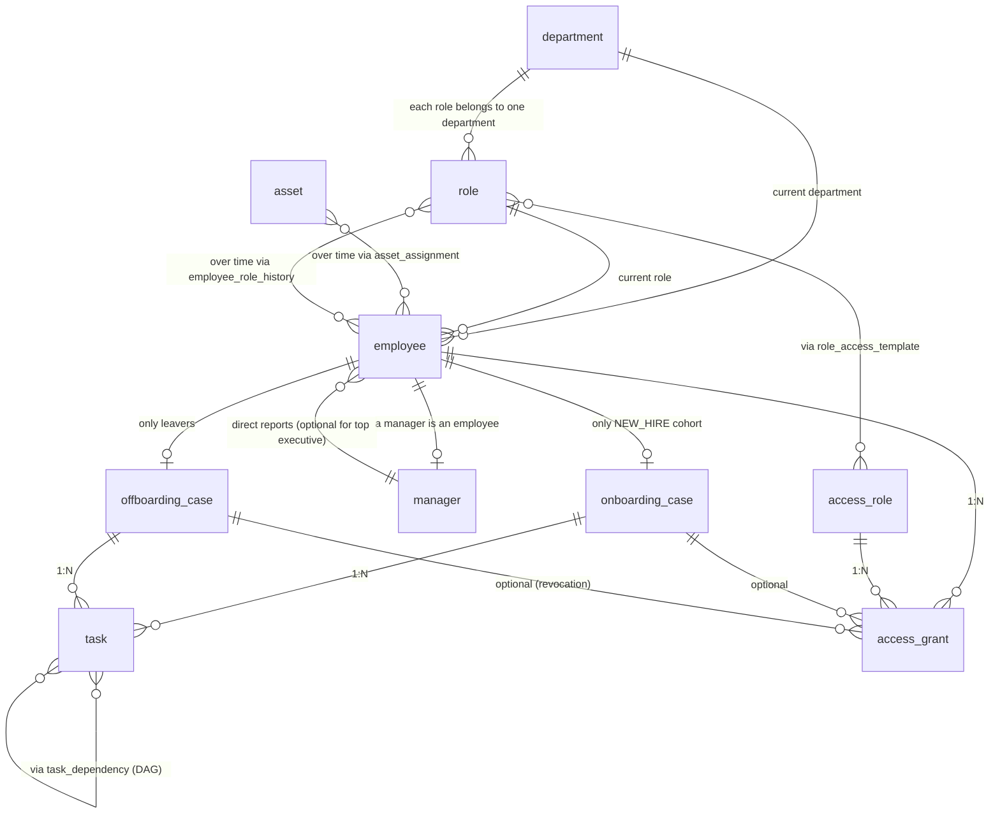

<!-- Generated by orchestrator.export.docs_writer from src/orchestrator/schema.py. Do not edit by hand. -->

# Entity-relationship diagram

## Cardinality

| Parent | Child | Cardinality | Note |
|---|---|---|---|
| `department` | `role` | 1:N | each role belongs to one department |
| `department` | `employee` | 1:N | current department |
| `role` | `employee` | 1:N | current role |
| `role` | `access_role` | N:M | via role_access_template |
| `employee` | `role` | N:M | over time via employee_role_history |
| `employee` | `manager` | 1:0..1 | a manager is an employee |
| `manager` | `employee` | 1:N | direct reports (optional for top executive) |
| `employee` | `onboarding_case` | 1:0..1 | only NEW_HIRE cohort |
| `employee` | `offboarding_case` | 1:0..1 | only leavers |
| `onboarding_case` | `task` | 1:N |  |
| `offboarding_case` | `task` | 1:N |  |
| `task` | `task` | N:M | via task_dependency (DAG) |
| `employee` | `access_grant` | 1:N |  |
| `access_role` | `access_grant` | 1:N |  |
| `onboarding_case` | `access_grant` | 1:N | optional |
| `offboarding_case` | `access_grant` | 1:N | optional (revocation) |
| `asset` | `employee` | N:M | over time via asset_assignment |
| `audit_event` | `every entity` | N:1 | polymorphic entity_type + entity_id |

N:M relationships are resolved with bridge tables: `role_access_template` (Role ↔ AccessRole), `employee_role_history` (Employee ↔ Role over time), `task_dependency` (Task ↔ Task) and `asset_assignment` (Asset ↔ Employee over time). `audit_event` references any entity through `entity_type` + `entity_id`.
